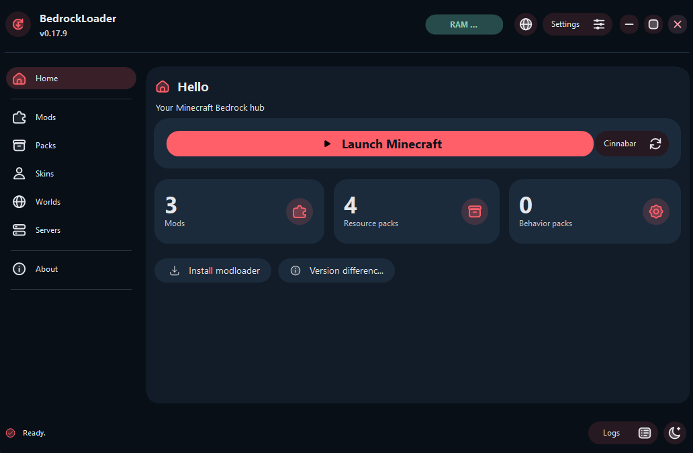
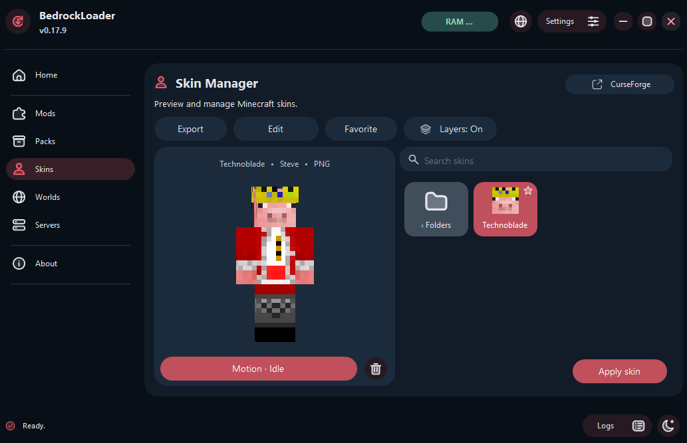
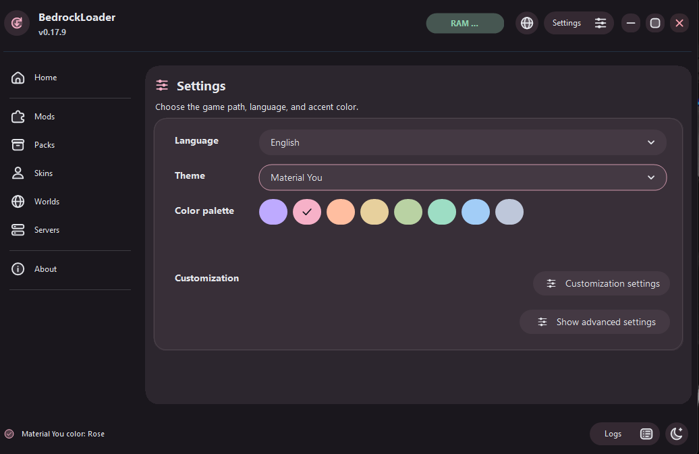

[Türkçe](README.md) | [English](README.en.md)

# BedrockLoader

BedrockLoader is a Windows launcher and content manager for **Minecraft Bedrock** and **Cinnabar**. Switch between clients from the home screen and manage your mods, packs, skins, worlds, and servers in one place.

[Windows x64 installer and release notes](https://github.com/kokluk/Bedrockloader/releases/tag/v0.17.9) · [Changelog (Turkish)](CHANGELOG.md)

## App preview

### Home

Launch Minecraft, switch to Cinnabar, and access your installed mods and packs.



### Skin manager and editor

Preview skins in 3D, add them to favorites, and use **Edit** to open the editor.



### Themes

Choose a preset theme or customize the interface with the Material You color palette.



## Installation

1. Open the [v0.17.9 release](https://github.com/kokluk/Bedrockloader/releases/tag/v0.17.9).
2. Download and run **BedrockLoader-Setup-v0.17.9-x64.exe** from **Assets**.
3. Choose your theme, effects, and Discord Rich Presence preferences in the setup wizard. A name for the home screen greeting is optional.

The installer includes the .NET runtime. To verify the download, compare the output below with **SHA256SUMS-v0.17.9.txt** from the same release.

```powershell
Get-FileHash .\BedrockLoader-Setup-v0.17.9-x64.exe -Algorithm SHA256
```

## Games and content

| Section | What you can do |
| --- | --- |
| **Minecraft Bedrock** | Detect and launch an installed copy, or start installation through the Microsoft Store. |
| **Cinnabar** | Download and verify the Windows package, check for updates, view local worlds, and manage compatible Java shader packs. |
| **Mods and packs** | Add local DLL mods, browse available versions in the Mod Center, and manage resource and behavior packs separately. |
| **Skins and worlds** | Preview skins in 3D, edit and export PNGs, apply skins through Minecraft, and import MCWORLD files. |
| **Servers** | Save IPv4, IPv6, and hostname entries, organize favorites, check latency, and add supported entries to Minecraft or copy addresses for Cinnabar. |

CurseForge catalogs are available for packs, worlds, skins, and Cinnabar shaders. Use the catalog’s **Connection** dialog if you need to enter an API key. Cinnabar is an independent Rust-based Bedrock client. Shader and server compatibility may differ between clients. [Cinnabar project](https://github.com/cinnabar-mc/cinnabar)

Install Minecraft for Windows through the Microsoft Store or Xbox app. The Cinnabar Mods page manages personal WASM files. Review and grant mod permissions in Cinnabar. Logs and available crash reports can be exported as ZIP files.

## Settings and backups

- **Customization** controls glow, animations, click sounds, RAM indicators, system tray behavior, and Discord Rich Presence.
- **Show advanced settings** opens RPC settings, backups, the game folder, and shortcuts. You can reopen the setup wizard from **Shortcuts**.
- Export settings and saved servers as JSON, or choose game content to include in a full ZIP backup. Import processes the selected items and preserves existing game files.
- The launcher keeps the latest 300 log lines. Closing the launcher sends it to the system tray by default. Opening it again restores the existing window.

## Build from source

On Windows, run this from the repository root with the **.NET 8 SDK** installed.

```powershell
dotnet build .\KoklukBedrockModloader.csproj -c Release
```

To build the Windows x64 installer, install **Inno Setup 6** and adjust the compiler path if needed.

```powershell
.\installer\build.ps1 -IsccPath 'C:\Program Files (x86)\Inno Setup 6\ISCC.exe'
```

The installer is written to **installer-output** and the standalone application to **installer-payload-v0.17.9**.

### Tests

```powershell
dotnet run --project .\tests\PackLibrary.Tests -c Release
dotnet run --project .\tests\BedrockServers.Tests -c Release
dotnet run --project .\tests\ReleaseUpdates.Tests -c Release -- .\installer-payload-v0.17.9\BedrockLoader.exe
```

Build the installer payload before running the updater test. The test uses the executable for file verification.

## Data and license

Settings, logs, and the local skin library are stored under **%APPDATA%\BedrockLoader**. Local mods are stored under **%APPDATA%\Minecraft bedrock\mods**.

[MIT License](LICENSE) · Project by Kokluk · Development and testing contributions by OpenAI Codex
