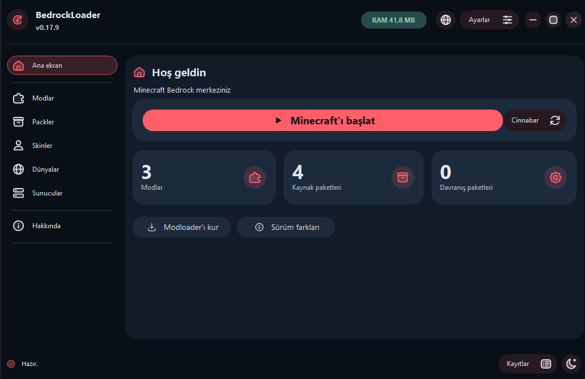
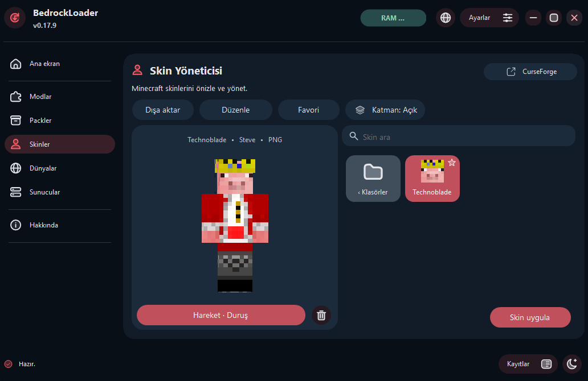
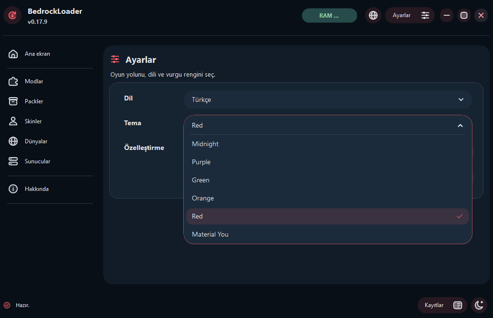

[Türkçe](README.md) | [English](README.en.md)

# BedrockLoader

BedrockLoader, **Minecraft Bedrock** ve **Cinnabar** için bir Windows başlatıcısı ve içerik yöneticisi. Ana ekrandan oyunlar arasında geçebilir, modlarını, paketlerini, skinlerini, dünyalarını ve sunucularını yönetebilirsin.

[Windows x64 kurulumu ve sürüm notları](https://github.com/kokluk/Bedrockloader/releases/tag/v0.17.14) · [Değişiklik geçmişi](CHANGELOG.md)

## Uygulama önizlemesi

### Ana ekran

Minecraft’ı başlat, Cinnabar’a geç ve yüklü modlarla paketlere tek yerden eriş.



### Skin yöneticisi ve editör

Skinleri 3B olarak önizle, favorilere ekle ve **Düzenle** düğmesiyle editörü aç.



### Temalar

AMOLED, koyu modda tam siyah arka plan kullanır ve Material You ile aynı sekiz vurgu rengini sunar.

Hazır temalar arasından seçim yap veya Material You renk paletiyle arayüzü özelleştir.



## Kurulum

1. [v0.17.14 sürüm sayfasını](https://github.com/kokluk/Bedrockloader/releases/tag/v0.17.14) aç.
2. **Assets** bölümünden **BedrockLoader-Setup-v0.17.14-x64.exe** dosyasını indir ve çalıştır.
3. İlk açılışta tema, animasyon, tıklama sesi ve Discord Rich Presence tercihlerini seç. İstersen ana ekrandaki selamlamada kullanılacak bir ad ekle.

Kurulum paketi .NET çalışma zamanını içerir. Dosyayı doğrulamak istersen, aynı sürümdeki **SHA256SUMS-v0.17.14.txt** dosyasıyla karşılaştırabilirsin.

```powershell
Get-FileHash .\BedrockLoader-Setup-v0.17.14-x64.exe -Algorithm SHA256
```

## Oyunlar ve içerik

| Bölüm | Yapabileceklerin |
| --- | --- |
| **Minecraft Bedrock** | Kurulu oyunu algıla ve başlat. Oyun bulunamazsa Microsoft Store üzerinden kurulumu dene. |
| **Cinnabar** | Ana ekrandan Cinnabar’a geç, Windows paketini indir ve doğrula, güncellemeleri denetle. Yerel dünyaları ve shader’ları görüntüle, CurseForge’dan uyumlu Java shader paketleri edin. |
| **Modlar ve paketler** | Yerel DLL modlarını dosya seçerek veya sürükleyip bırakarak ekle. Mod Merkezi’ndeki sürümleri incele. Kaynak ve davranış paketlerini ayrı listelerde yönet. |
| **Skinler ve dünyalar** | Skinleri döndürülebilir 3B önizlemede incele, favorilere ekle ve renk çarkıyla düzenle. PNG olarak dışa aktar, şeffaf PNG bindir veya Minecraft’a uygula. Yerel dünyaları görüntüle ve MCWORLD dosyalarını içe aktar. |
| **Sunucular** | IPv4, IPv6 veya alan adıyla sunucu kaydet. Favorileri, ping’i ve kayıtları yönet. Uygun kayıtları Minecraft’a ekle veya adresi Cinnabar’da kullanmak için kopyala. |

CurseForge katalogları paketler, dünyalar, skin paketleri ve Cinnabar shader’ları için ayrı açılır. Anahtar gerekiyorsa ilgili katalogdaki **Bağlantı** penceresini kullan.

Cinnabar, Rust ile geliştirilen bağımsız bir Bedrock istemcisidir. Shader ve sunucu uyumluluğu istemciye göre değişebilir. Ana ekrandaki **Sürüm farkları** düğmesinden iki istemciyi karşılaştırabilirsin. [Cinnabar projesi](https://github.com/cinnabar-mc/cinnabar)

Minecraft for Windows kurulumu Microsoft Store veya Xbox üzerinden tamamlanır. Cinnabar modları ekranı kişisel WASM dosyalarını yönetir. Mod izinlerini Cinnabar içinde onaylayabilirsin. Kayıtlar ve mevcut çökme raporları ZIP olarak dışa aktarılabilir.

## Ayarlar ve yedekleme

- **Özelleştirme** penceresinden parlama, animasyonlar, tıklama sesi, RAM göstergesi ve sistem tepsisi davranışını ayarlayabilirsin. Tıklama sesi ve kaynak göstergeleri yeni kurulumlarda kapalı gelir.
- **Gelişmiş ayarları göster** düğmesi Discord RPC, Yedekler, Content klasörü ve Kısayollar’ı açar. Kurulum sihirbazı **Kısayollar** üzerinden tekrar başlatılabilir.
- **Ayarları dışa aktar** ile ayarlarını ve kayıtlı sunucularını JSON olarak saklayabilirsin. **Tam yedeği dışa aktar** ile dünyaları, skinleri, paketleri, modları ve Cinnabar verilerini seçerek ZIP’e ekleyebilirsin. İçe aktarmada seçili öğeler işlenir ve mevcut oyun dosyaları korunur.
- Discord Rich Presence açıkken Minecraft sürümü, oyun süresi ve girdiysen yerel adın etkinlikte görünebilir. Kayıtlar son 300 satırı seçili arayüz dilinde tutar.

Launcher kapatıldığında varsayılan olarak sistem tepsisine iner. İkinci kez başlatıldığında açık örneğin penceresi geri gelir.

## Kaynak koddan derleme

Windows ve **.NET 8 SDK** ile, depo kökünde çalıştır:

```powershell
dotnet build .\KoklukBedrockModloader.csproj -c Release
```

Windows x64 kurulum paketi üretmek için **Inno Setup 6** gerekir. Gerekirse komuttaki ISCC yolunu kendi kurulumuna göre değiştir:

```powershell
.\installer\build.ps1 -IsccPath 'C:\Program Files (x86)\Inno Setup 6\ISCC.exe'
```

Kurulum EXE’si **installer-output** klasörüne, bağımsız uygulama dosyaları **installer-payload-v0.17.14** klasörüne çıkar.

### Testler

```powershell
dotnet run --project .\tests\PackLibrary.Tests -c Release
dotnet run --project .\tests\BedrockServers.Tests -c Release
dotnet run --project .\tests\ReleaseUpdates.Tests -c Release -- .\installer-payload-v0.17.14\BedrockLoader.exe
```

Güncelleyici testi için önce kurulum derleme betiğini çalıştır. Test, verilen EXE’yi çalıştırmadan dosya doğrulamasında kullanır.

## Veri konumları ve lisans

- Ayarlar, kayıtlar ve launcher skin kütüphanesi **%APPDATA%\BedrockLoader** altında tutulur.
- Yerel modlar **%APPDATA%\Minecraft bedrock\mods** altında tutulur.
- Windows kurulum dosyaları GitHub Releases üzerinden dağıtılır. Depo, kaynak kodu ve derleme betiklerini içerir.

[MIT Lisansı](LICENSE) · Proje sahibi Kokluk · Geliştirme ve test katkısı OpenAI Codex
